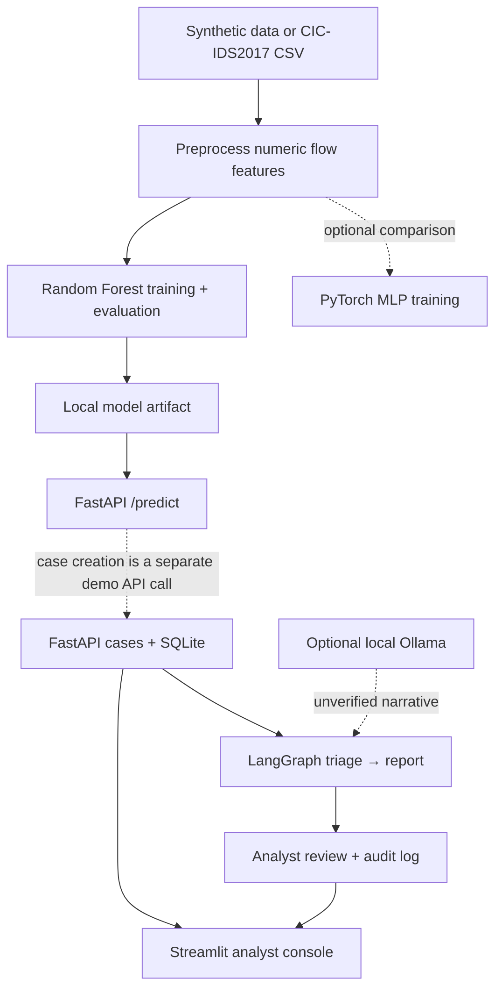

# AegisSOC-X Enterprise

**AI-assisted security investigation | Network-flow machine learning | Human-in-the-loop SOC workflow**

AegisSOC-X is a local, reproducible **cybersecurity + applied AI engineering portfolio prototype**. It connects network-flow classification to an analyst-facing case investigation workflow: a scikit-learn Random Forest produces a risk score; FastAPI manages predictions and cases; a bounded LangGraph workflow prepares evidence and a cautious summary; optional Ollama adds an **unverified** local-LLM narrative; and a Streamlit console supports analyst review and audit inspection.

> **Project status — working prototype, not a production SOC platform.** This repository does not provide autonomous remediation, authentication/RBAC, independent agent tool selection, validated enterprise threat detection, or measured financial ROI. The default synthetic dataset is for smoke testing only. The CIC-IDS2017 baseline uses a random stratified row split, which may leak correlated flows and overstate generalization.

## Project at a glance

| Area | Implemented in this repository | Why it matters |
| --- | --- | --- |
| Security data | Synthetic smoke-test generator and CIC-IDS2017 CSV ingestion | Reproducible data preparation and binary labels |
| Classical ML | Median imputation + Random Forest; precision, recall, F1, PR-AUC, FPR, confusion matrix | Measurable alert classification |
| Deep learning | Optional PyTorch multilayer perceptron with validation and early stopping | Practical neural-network training and comparison |
| Backend | FastAPI `/health`, `/predict`, case creation, investigation, review and audit endpoints | Model serving and workflow integration |
| Investigation | Bounded LangGraph triage → report workflow | Evidence-oriented AI orchestration |
| Local LLM | Optional Ollama-generated narrative with deterministic fallback | Local inference and human verification |
| Analyst experience | Streamlit case queue, review controls and audit table | Human-in-the-loop operational workflow |
| Engineering | uv, pytest, Ruff and GitHub Actions workflow | Repeatable build and quality checks |

## Architecture



**Important boundary:** `/predict` and `/cases` are separate endpoints in the current implementation; predictions are **not automatically converted into cases**. Case creation accepts a supplied demonstration score. The LangGraph flow is deterministic and does not independently select tools.

## Demonstration — screenshots from the build

The images below were selected from the original screenshots supplied with this repository and organized into a technical walkthrough. They show local development evidence, not a certified production deployment.

### 1. Development environment and project structure

Python/uv development in VS Code with WSL Ubuntu and the local repository.


### 2. Real network-flow data and Random Forest training

The CIC-IDS2017 CSV ingestion and training workflow. Raw dataset files and trained artifacts are intentionally excluded from the published repository.


### 3. Model evaluation

Inspect the model's recorded metrics and remember that the random-row split is a **baseline only**, not a deployment-valid estimate. See [evaluation methodology and limitations](docs/EVALUATION.md).


### 4. Neural-network experiment

Optional PyTorch MLP training provides a second modeling approach. A defensible model comparison requires identical held-out test data.


### 5. API and prediction workflow

FastAPI exposes a typed prediction endpoint and case-management operations. Test with the interactive API documentation at `http://127.0.0.1:8000/docs`.


### 6. Case investigation and evidence-oriented reporting

LangGraph assembles case-record and model-score evidence into a preliminary report; analysts retain responsibility for disposition.


### 7. Optional local-LLM integration

Ollama can generate a narrative from the provided evidence. The application labels this text **unverified** and falls back to a deterministic summary when the LLM is unavailable.


### 8. Analyst dashboard

Streamlit surfaces the case queue, investigation actions, review form, and audit trail.


For additional chronological build evidence, see the original timestamped images in [`docs/screenshots/`](docs/screenshots/).

## Quick start — Windows + WSL Ubuntu

**Prerequisites:** Python 3.11–3.13 (3.12 recommended), [uv](https://docs.astral.sh/uv/), Git and a WSL Ubuntu terminal. Docker is **not required** for this version.

```bash
# In the cloned repository
uv sync --group dev --python 3.12

# Reproducible synthetic smoke test
uv run python -m aegissoc.train

# Validate the code
uv run pytest -q
uv run ruff check .
```

Start the API in **terminal 1**:

```bash
uv run uvicorn aegissoc.api:app --host 127.0.0.1 --reload
```

Start the analyst console in **terminal 2**:

```bash
uv run streamlit run src/aegissoc/dashboard.py
```

Open **[FastAPI docs](http://127.0.0.1:8000/docs)** and **[Streamlit console](http://localhost:8501)** on your machine. Keep the unauthenticated API on localhost only.

### Train on CIC-IDS2017

1. Obtain the **MachineLearningCSV** data from the [official Canadian Institute for Cybersecurity page](https://www.unb.ca/cic/datasets/ids-2017.html).
2. Select a CSV containing both `BENIGN` and attack labels; save it locally as `data/raw/flows.csv`.
3. Run:

```bash
uv run python -m aegissoc.train --csv data/raw/flows.csv
cat artifacts/metrics.json
```

**Evaluation caution:** The model uses a stratified random 80/20 row split. Correlated flow records can appear in both partitions. Before making performance claims, evaluate by held-out capture day/session or another defensible grouping and report class-specific results. Dataset files and `artifacts/` are excluded from Git.

### Train the PyTorch MLP (optional)

```bash
uv sync --group dev --extra deep-learning
uv run python -m aegissoc.neural --csv data/raw/flows.csv
cat artifacts/mlp_metrics.json
```

The PyTorch experiment has its own training/validation process. Do not claim the Random Forest and MLP are fairly benchmarked until both use the same saved test split.

### Create, investigate and review a demonstration case

With the API running:

```bash
curl -X POST http://127.0.0.1:8000/cases \
  -H 'Content-Type: application/json' \
  -d '{"score":0.91,"event":{"id":"demo-001","source":"synthetic","description":"Demo security event"}}'

# Replace 1 with the returned case ID
curl -X POST http://127.0.0.1:8000/cases/1/investigate
curl -X POST http://127.0.0.1:8000/cases/1/review \
  -H 'Content-Type: application/json' \
  -d '{"reviewer":"demo-analyst","decision":"needs_more_evidence"}'
curl http://127.0.0.1:8000/audit
```

The `0.91` value above is **supplied for demonstration**, not a model-generated detection score.

### Enable Ollama (optional)

Install [Ollama](https://github.com/ollama/ollama) and ensure the service is accessible from WSL:

```bash
ollama pull llama3.2
USE_OLLAMA=1 uv run uvicorn aegissoc.api:app --host 127.0.0.1 --reload
```

You can configure `OLLAMA_URL` and `OLLAMA_MODEL`. LLM text is not verified threat intelligence and must be reviewed.

## Repository structure

```text
.github/workflows/ci.yml     GitHub Actions lint/test workflow
src/aegissoc/data.py         Dataset loading and label processing
src/aegissoc/train.py        Random Forest training and metrics
src/aegissoc/neural.py       Optional PyTorch MLP experiment
src/aegissoc/api.py          FastAPI endpoints and SQLite cases
src/aegissoc/agent.py        Bounded LangGraph investigation
src/aegissoc/dashboard.py    Streamlit analyst console
tests/test_pipeline.py       Synthetic-data, training and graph tests
docs/                       Architecture, build, demo, evaluation and screenshots
```

## Engineering validation

```bash
uv run pytest -q
uv run ruff check .
```

The supplied repository includes **three pytest tests** and a GitHub Actions workflow that runs Ruff and pytest. Local test success was reported during development; a passing remote Actions run should be confirmed on the [Actions page](https://github.com/Faizefied393/AegisSOC-X-Enterprise/actions), rather than assumed.

## Security and evaluation limitations

- **Local-only demonstration:** No login, SSO, RBAC, TLS termination or production secrets management. Do not expose the API to the internet.
- **No autonomous response:** The graph does not execute containment, blocking, shell commands or destructive actions.
- **Limited agent autonomy:** Two fixed LangGraph nodes; no independently selected external investigation tools.
- **Model generalization not established:** CIC-IDS2017 is historical and random row splitting may inflate scores.
- **LLM reliability:** Ollama output is unverified narrative, not confirmed evidence.
- **Prototype storage:** SQLite is suitable for local demonstrations; production would need stronger access controls, migrations, and operational monitoring.
- **Business impact:** No measured analyst time savings, SOC effectiveness, or financial ROI is claimed.

## Planned improvements (not implemented yet)

1. **ML reliability:** Group/time-based holdout, threshold calibration, XGBoost benchmark, MLflow tracking, model drift and latency evaluation.
2. **Agentic security:** Evidence-retrieval tools, tool-level authorization, structured citations, bounded tool selection and prompt-injection tests.
3. **Application security:** Authentication/RBAC, audit integrity, secrets handling and adversarial API testing.
4. **Deployment:** PostgreSQL, migrations, Docker Compose, monitoring and release controls.
5. **Business validation:** Controlled manual-versus-assisted investigations, measured analyst effort, error rates and cost assumptions.

## Documentation

- [Complete build and screenshot walkthrough](docs/COMPLETE_WALKTHROUGH.md)
- [Architecture](docs/ARCHITECTURE.md)
- [Build notes](docs/BUILD.md)
- [Evaluation plan](docs/EVALUATION.md)
- [Demo walkthrough](docs/DEMO.md)

## Sources, documentation and upstream repositories

The following resources correspond to the dataset, libraries, frameworks, tooling, and security guidance used in the codebase or referenced during the build. **They are third-party projects and documentation, not code repositories authored for AegisSOC-X.** Resources for future upgrades are identified separately.

| Area | Resource | Role in this project |
| --- | --- | --- |
| Security dataset | [UNB CIC-IDS2017](https://www.unb.ca/cic/datasets/ids-2017.html) | Historical labeled network-flow CSV source |
| ML | [scikit-learn documentation](https://scikit-learn.org/stable/) · [GitHub](https://github.com/scikit-learn/scikit-learn) | Random Forest, imputation, train/test split, evaluation |
| Data processing | [pandas](https://pandas.pydata.org/docs/) · [GitHub](https://github.com/pandas-dev/pandas) | CSV parsing, numeric feature preparation |
| Numerical computing | [NumPy](https://numpy.org/doc/stable/) · [GitHub](https://github.com/numpy/numpy) | Arrays and synthetic-data preparation |
| Neural networks | [PyTorch tutorials](https://pytorch.org/tutorials/) · [GitHub](https://github.com/pytorch/pytorch) | Optional MLP training |
| API | [FastAPI](https://fastapi.tiangolo.com/) · [GitHub](https://github.com/fastapi/fastapi) | Inference and case API |
| Schemas | [Pydantic](https://docs.pydantic.dev/) · [GitHub](https://github.com/pydantic/pydantic) | Request validation |
| Agent orchestration | [LangGraph](https://docs.langchain.com/oss/python/langgraph/overview) · [GitHub](https://github.com/langchain-ai/langgraph) | Bounded investigation graph |
| Local LLM | [Ollama](https://github.com/ollama/ollama) · [Model library](https://ollama.com/library) | Optional local narrative generation |
| UI | [Streamlit](https://docs.streamlit.io/) · [GitHub](https://github.com/streamlit/streamlit) | Analyst console |
| Python packaging | [uv](https://docs.astral.sh/uv/) · [GitHub](https://github.com/astral-sh/uv) | Dependencies, Python environment, commands |
| Testing | [pytest](https://docs.pytest.org/) · [GitHub](https://github.com/pytest-dev/pytest) | Automated tests |
| Linting | [Ruff](https://docs.astral.sh/ruff/) · [GitHub](https://github.com/astral-sh/ruff) | Code quality |
| CI | [GitHub Actions](https://docs.github.com/en/actions) | Automated lint/test workflow |
| Editor | [VS Code WSL](https://code.visualstudio.com/docs/remote/wsl) | Windows-to-Ubuntu development |
| Data storage | [SQLite](https://www.sqlite.org/docs.html) | Local case and audit persistence |
| Serialization | [joblib](https://joblib.readthedocs.io/) | Local model artifact serialization |

**Security and evaluation references:** [OWASP Top 10 for LLM Applications](https://genai.owasp.org/), [OWASP API Security](https://owasp.org/www-project-api-security/), [MITRE ATT&CK](https://attack.mitre.org/), [scikit-learn cross-validation](https://scikit-learn.org/stable/modules/cross_validation.html), and [model evaluation](https://scikit-learn.org/stable/modules/model_evaluation.html). These inform design and planned validation; the current repository does not implement all recommended controls.

**Future-upgrade references (not current integrations):** [XGBoost](https://xgboost.readthedocs.io/) · [GitHub](https://github.com/dmlc/xgboost), [MLflow](https://mlflow.org/docs/latest/) · [GitHub](https://github.com/mlflow/mlflow), [Docker Compose](https://docs.docker.com/compose/), [PostgreSQL](https://www.postgresql.org/docs/), and [Hugging Face Agents Course](https://huggingface.co/learn/agents-course/).

## Attribution

AegisSOC-X is an independently assembled portfolio prototype using the above open-source libraries, frameworks and public documentation. Dataset attribution belongs to the Canadian Institute for Cybersecurity, University of New Brunswick. Follow each upstream project's applicable license and the dataset's usage terms.

